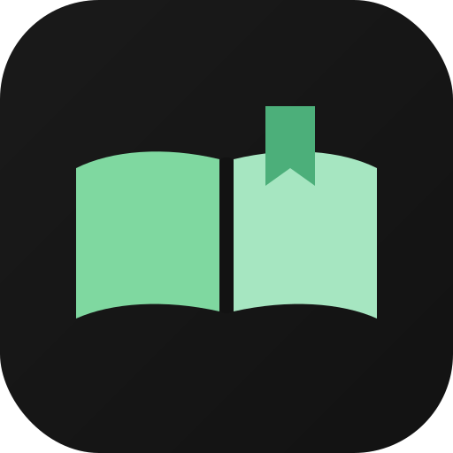
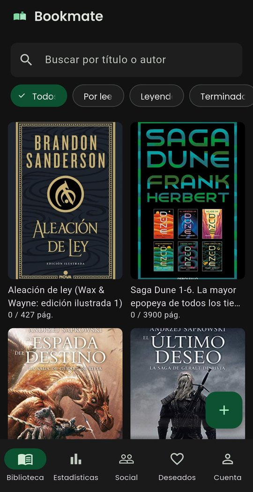
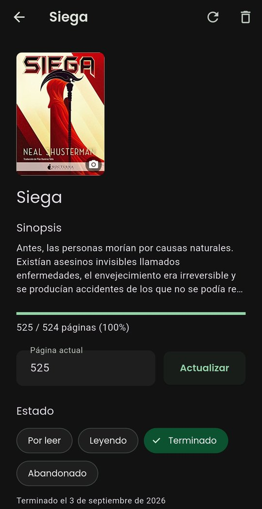
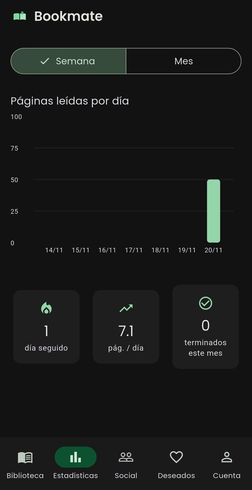
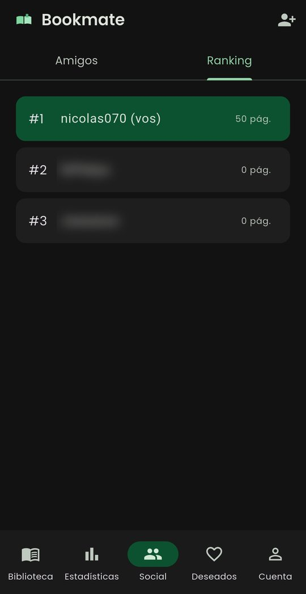
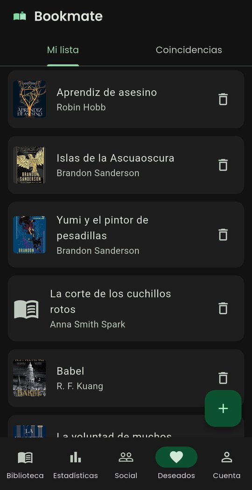
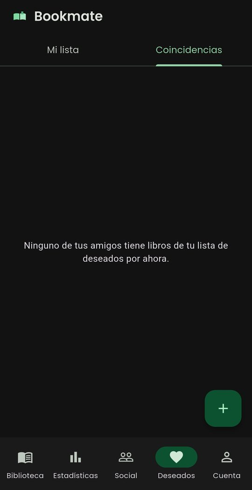
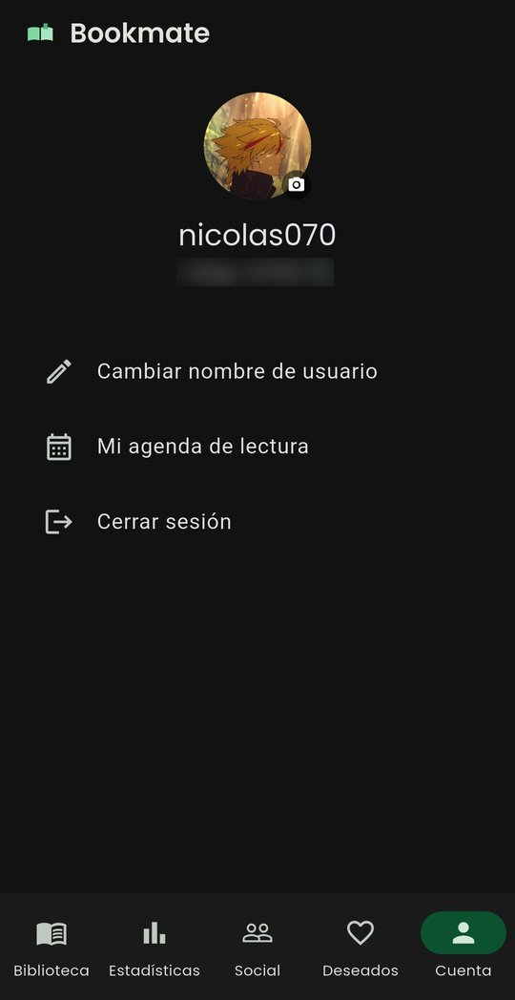
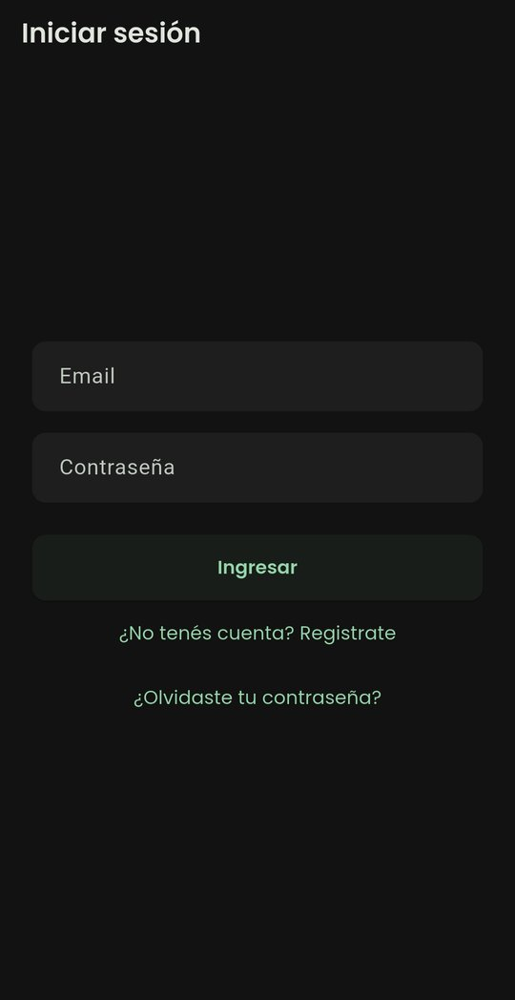

  

<h1 align="center">Bookmate</h1>

  App Android para registrar tus lecturas, ver tus estadísticas y compartir tu biblioteca con amigos.

  <a href="https://github.com/nicolasreynoso070/bookmate-releases/releases/latest"><b>⬇ Descargar la última versión</b></a>
  ·
  <a href="docs/Manual_Tecnico_Bookmate.pdf"><b>📘 Manual técnico</b></a>

---

## Capturas

| Biblioteca | Ficha del libro | Estadísticas | Ranking |
|:---:|:---:|:---:|:---:|
|  |  |  |  |

| Deseados | Coincidencias | Cuenta | Inicio de sesión |
|:---:|:---:|:---:|:---:|
|  |  |  |  |

## Funcionalidades

- **Biblioteca personal**: agregá libros escaneando el código de barras, escribiendo el ISBN o buscando por título. Filtrá por estado (por leer, leyendo, terminado, abandonado) y buscá por título o autor.
- **Progreso de lectura**: registrá la página en la que quedaste y la app guarda cuánto leíste cada día.
- **Estadísticas**: gráfico de páginas por día (semana o mes), racha de días seguidos, promedio diario y libros terminados en el mes.
- **Amigos**: agregá amigos con su código, mirá sus bibliotecas y competí en un ranking semanal de páginas leídas.
- **Préstamos**: registrá qué libro le prestaste a quién. Al amigo le aparece como "prestado" en su biblioteca y a vos como "prestando".
- **Lista de deseados**: anotá los libros que querés y descubrí cuáles de tus amigos ya los tienen.
- **Agenda de lectura**: configurá días y horarios y recibí recordatorios, incluso sin conexión.
- **Actualizaciones automáticas**: cuando hay una versión nueva, la app te ofrece instalarla.

## Instalación

1. Desde el celular, entrá a [Releases](https://github.com/nicolasreynoso070/bookmate-releases/releases/latest).
2. En **Assets**, descargá el archivo `.apk`.
3. Abrilo. Si Android lo pide, permití instalar apps desde el navegador o el administrador de archivos.
4. Si aparece un aviso de Play Protect, elegí **Instalar de todas formas** (la app se distribuye fuera de Google Play).
5. Creá tu cuenta, confirmá el correo e iniciá sesión.

Las versiones siguientes se instalan desde la propia app, sin repetir estos pasos.

## Cómo está construida

| Área | Tecnología |
|---|---|
| Aplicación | Flutter (Dart), Android |
| Backend | Supabase: PostgreSQL, autenticación y almacenamiento |
| Datos de libros | Open Library (principal) y Google Books (complemento) |
| Publicación | GitHub Actions: compilación, firma y release automáticos |

El **[manual técnico](docs/Manual_Tecnico_Bookmate.pdf)** documenta la arquitectura, el modelo de datos, la lógica del servidor, el funcionamiento de cada flujo (búsqueda en cascada, préstamos, ranking, actualización automática) y el proceso de publicación, sin incluir código fuente ni credenciales.

## Este repositorio

Este repositorio contiene solo las **versiones compiladas** de la app y su **documentación**. El código fuente se mantiene en un repositorio separado.

## Autoría

Diseño del modelo de datos, definición de funcionalidades y estructura de la aplicación: **Nicolás Reynoso Cabello**, estudiante de la Licenciatura en Ciencias de la Computación (Universidad Nacional de San Juan).
La implementación se desarrolló con asistencia de inteligencia artificial (Claude, de Anthropic) bajo su dirección. Las pruebas y la depuración también estuvieron a su cargo.
